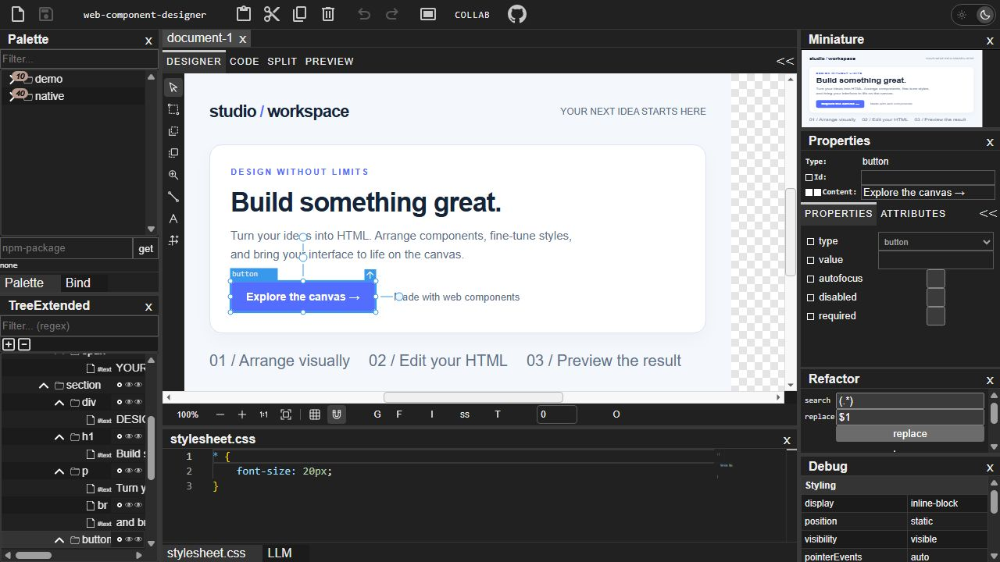
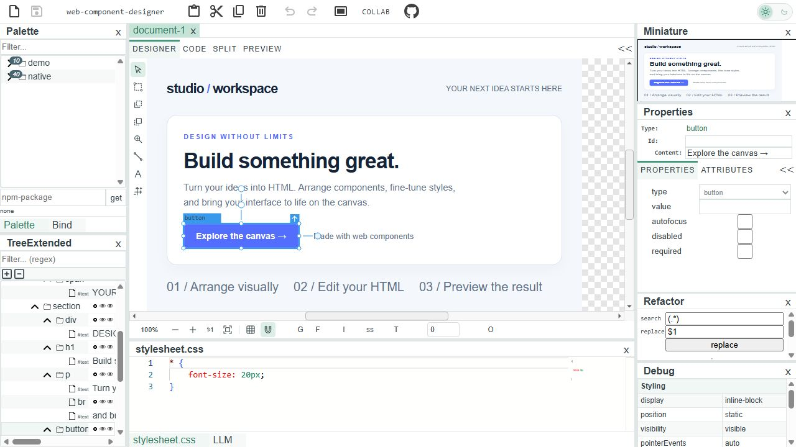

# web-component-designer

[](https://www.npmjs.com/package/@node-projects/web-component-designer)
[](https://www.npmjs.com/package/@node-projects/web-component-designer)
[](https://github.com/node-projects/web-component-designer/blob/master/LICENSE)
[](https://github.com/node-projects/web-component-designer/actions/workflows/release.yml)
[](https://node-projects.github.io/web-component-designer-demo/index.html)

An embeddable visual editor for HTML pages and web components. Build an editor into your own application with a design canvas, HTML source editing, a component palette, a document tree, and property inspectors.

Originally based on PolymerLabs' wizzywid, the designer now uses standard web components and TypeScript without a Polymer runtime.

[Try the full demo](https://node-projects.github.io/web-component-designer-demo/index.html) · [Try the simple demo](https://node-projects.github.io/web-component-designer-simple-demo/index.html) · [npm package](https://www.npmjs.com/package/@node-projects/web-component-designer) · [Framework comparison](COMPARISON.md)



## What you can build

- **Visual HTML editing:** select, drag, resize, rotate, and edit elements on the canvas, with undo/redo and copy/paste.
- **Layout tools:** work with absolute positioning, Flexbox, and CSS Grid; use snapping, alignment, spacing, zoom, and pan controls.
- **Source and preview views:** switch between the visual designer, HTML source, a split view, and a rendered preview.
- **Component tooling:** expose native HTML, SVG, and custom elements through palettes, document trees, and property editors. Load component definitions from a Custom Elements Manifest.
- **An editor that fits your app:** customize services, tools, inspectors, and the UI's CSS custom properties. See the [theming reference](packages/web-component-designer/THEMING.md).
- **Specialized editors:** extend the designer with collaboration, visualization bindings and scripts, Mermaid diagrams, or ZPL label tools.

## Installation and integration

```sh
npm install @node-projects/web-component-designer
```

Use a browser application with a bundler that resolves npm imports. Create the default services, then mount a document container:

```ts
import {
  createDefaultServiceContainer,
  DocumentContainer,
} from '@node-projects/web-component-designer';

const services = createDefaultServiceContainer();
const designer = new DocumentContainer(
  services,
  '<button style="padding: 12px 20px">Hello, designer!</button>',
);
designer.style.cssText = 'display: block; height: 600px;';
document.body.appendChild(designer);
await designer.whenReady();

// Commit pending source edits before reading the current HTML.
async function getHtml() {
  await designer.commitPendingChanges();
  return designer.content;
}
```

This mounts the document editor with its Designer, Code, Split, and Preview tabs. The default services include a simple code editor. Add palette, tree, and property widgets to build a full editor shell; the [simple demo source](https://github.com/node-projects/web-component-designer-simple-demo) and [full demo source](https://github.com/node-projects/web-component-designer-demo) show how to connect them.

The core package depends on `@node-projects/base-custom-webcomponent`. Rich code editors and other integrations live in optional packages, so you can choose the dependencies your application needs.

## Screenshots

The full demo in a light theme, with the same HTML document and selected button:



These screenshots show the hosted demo shell; the core document container is one part of that application. See the [sample and capture instructions](packages/web-component-designer/docs/SCREENSHOTS.md) to reproduce them.

## Optional packages

All packages below use the `@node-projects/` npm scope. Install the integrations you need and register them with your service container; see each package's README for setup.

| Package | Purpose |
| --- | --- |
| [`web-component-designer-codeview-ace`](packages/web-component-designer-codeview-ace/README.md) | HTML source editing with Ace. |
| [`web-component-designer-codeview-codemirror`](packages/web-component-designer-codeview-codemirror/README.md) | HTML source editing with CodeMirror 6. |
| [`web-component-designer-codeview-codemirror5`](packages/web-component-designer-codeview-codemirror5/README.md) | HTML source editing with CodeMirror 5. |
| [`web-component-designer-codeview-monaco`](packages/web-component-designer-codeview-monaco/README.md) | HTML source editing with Monaco; see the package README for editor loading. |
| [`web-component-designer-collaboration-service`](packages/web-component-designer-collaboration-service/README.md) | Per-document collaboration with remote cursors, selections, comments, and WebRTC transport. |
| [`web-component-designer-htmlparserservice-base-custom-webcomponent`](packages/web-component-designer-htmlparserservice-base-custom-webcomponent/README.md) | Extract HTML templates from BaseCustomWebComponent classes. |
| [`web-component-designer-htmlparserservice-lit-element`](packages/web-component-designer-htmlparserservice-lit-element/README.md) | Extract HTML templates from Lit element render methods. |
| [`web-component-designer-htmlparserservice-nodehtmlparser`](packages/web-component-designer-htmlparserservice-nodehtmlparser/README.md) | Parse HTML using the Node HTML Parser integration. |
| [`web-component-designer-stylesheetservice-css-parser`](packages/web-component-designer-stylesheetservice-css-parser/README.md) | Parse and edit stylesheets using @node-projects/css-parser. |
| [`web-component-designer-widgets-wunderbaum`](packages/web-component-designer-widgets-wunderbaum/README.md) | Extended document tree and palette widgets built with Wunderbaum. |
| [`web-component-designer-visualization-addons`](packages/web-component-designer-visualization-addons/README.md) | Bindings and scripting building blocks for visualization editors. |
| [`web-component-designer-mermaid`](packages/web-component-designer-mermaid/README.md) | Widgets and services for building a Mermaid diagram designer. |
| [`web-component-designer-zpl`](packages/web-component-designer-zpl/README.md) | Widgets and services for building a ZPL label designer. |

The built-in tree widgets do not require a third-party tree library. Use the Wunderbaum package for the extended tree and palette views.

## Examples and projects

- [Full designer demo](https://github.com/node-projects/web-component-designer-demo): an editor shell with docked panels, a palette, document tree, properties, stylesheets, and code editing.
- [Simple designer demo](https://github.com/node-projects/web-component-designer-simple-demo): a smaller starting point for embedding the designer.
- [VS Code designer add-on](https://github.com/node-projects/vs-code-designer-addon): use the designer inside VS Code.
- [ZPL label designer demo](https://github.com/node-projects/web-component-designer-zpl-demo): a specialized editor for printer labels.

The designer is also used in commercial material-flow layout editors and flow-chart editors.

## Browser and touch support

The project targets Chrome, Firefox, and Safari. Test your integration and chosen add-ons in the browsers you support.

For touch drag-and-drop, the demos can use the optional `mobile-drag-drop` polyfill. Install it and include its stylesheet and script when your application needs it:

```html
<link rel="stylesheet" href="/node_modules/mobile-drag-drop/default.css">
<script src="/node_modules/mobile-drag-drop/index.js"></script>
```

## Development

This repository is an npm-workspaces monorepo. From the repository root:

```sh
npm ci
npm run build
npm test -- --runInBand
```

To build only the core package:

```sh
npm run build --workspace=@node-projects/web-component-designer
```

For local development across linked demo repositories, `npm run develop` installs dependencies, runs `npm link` for the workspaces, and builds them. Linking changes npm's global links, so use it when you need that workflow. The demos are separate repositories; this repository contains the editor packages.

Report bugs and discuss upcoming work in [GitHub Issues](https://github.com/node-projects/web-component-designer/issues).

## Publishing releases

Publish a GitHub release with a tag such as `v1.2.3` or `1.2.3-rc.1`.
The `release.yml` workflow checks out that tag, sets every public workspace's
`package.json` version and internal dependencies to the release version, and
updates the lockfile in the build checkout. These version edits are not pushed
back to the repository.

All packages run their existing `prepublishOnly` preparation, including bundles
and asset copies. The workflow attaches every npm `.tgz` archive to the GitHub
release, then publishes those same archives publicly to npm. Stable releases use
the `latest` npm tag; prerelease versions and GitHub prereleases use `next`.
The private monorepo root is not published. Use a new, unpublished version for
each release; npm does not allow overwriting a published package version.

Before the first release, configure each npm package's trusted publisher for
GitHub Actions: owner `node-projects`, repository `web-component-designer`, and
workflow `release.yml` (no environment). See the
[npm trusted publishing instructions](https://docs.npmjs.com/trusted-publishers/).
Alternatively, add a repository Actions secret named `NPM_TOKEN` with publishing
access to all packages. The workflow uses it when present.

To check the version preparation locally, run `node --test scripts/prepare-release.test.mjs`.

To publish an existing release using the latest workflow (for example, after
fixing a workflow failure), run
`gh workflow run release.yml --ref master -f release_tag=1.2.3`.
The workflow still builds the source at the specified release tag. Retry only
when that version has not yet been published to npm.

## License and acknowledgments

[MIT](LICENSE). Some icons come from [Chrome DevTools](https://github.com/ChromeDevTools/devtools-frontend/tree/main/front_end/Images/src); see its [license](https://github.com/ChromeDevTools/devtools-frontend/blob/main/LICENSE) and this repository's [acknowledgments](ACKNOWLEDGMENTS).
