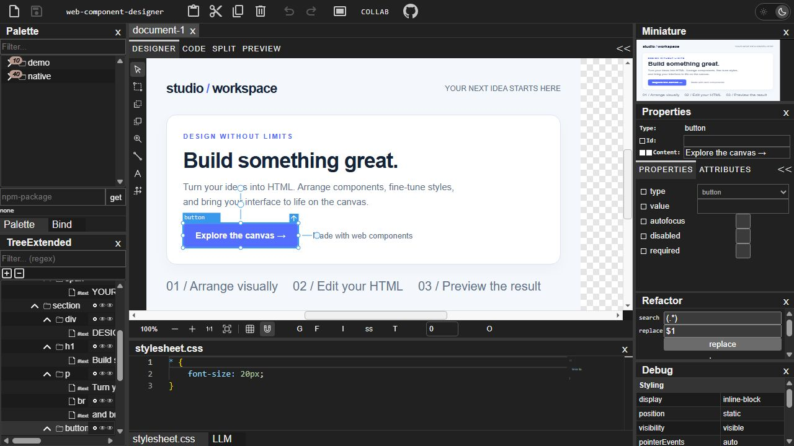

# web-component-designer

[](https://www.npmjs.com/package/@node-projects/web-component-designer)
[](https://www.npmjs.com/package/@node-projects/web-component-designer)
[](https://github.com/node-projects/web-component-designer/blob/master/LICENSE)
[](https://github.com/node-projects/web-component-designer/actions/workflows/release.yml)
[](https://node-projects.github.io/web-component-designer-demo/index.html)

An embeddable visual editor for HTML pages and web components. Build an editor into your own application with a design canvas, HTML source editing, a component palette, a document tree, and property inspectors.

Originally based on PolymerLabs' wizzywid, the designer now uses standard web components and TypeScript without a Polymer runtime.



## Installation and integration

```sh
npm install @node-projects/web-component-designer
```

Use a browser application with a bundler that resolves npm imports. Create the default services, then mount a document container:

```ts
import {
  createDefaultServiceContainer,
  DocumentContainer,
} from '@node-projects/web-component-designer';

const services = createDefaultServiceContainer();
const designer = new DocumentContainer(
  services,
  '<button style="padding: 12px 20px">Hello, designer!</button>',
);
designer.style.cssText = 'display: block; height: 600px;';
document.body.appendChild(designer);
await designer.whenReady();

// Commit pending source edits before reading the current HTML.
async function getHtml() {
  await designer.commitPendingChanges();
  return designer.content;
}
```

This mounts the document editor with its Designer, Code, Split, and Preview tabs. The default services include a simple code editor. Add palette, tree, and property widgets to build a full editor shell; the [simple demo source](https://github.com/node-projects/web-component-designer-simple-demo) and [full demo source](https://github.com/node-projects/web-component-designer-demo) show how to connect them.

The core package depends on `@node-projects/base-custom-webcomponent`. Rich code editors and other integrations live in optional packages, so you can choose the dependencies your application needs.

## Features

- Visual selection, drag-and-drop, resizing, rotation, snapping, and layout tools.
- HTML source, split, and preview views alongside the design canvas.
- Undo/redo, copy/paste, custom element palettes, document trees, and property inspectors.
- Configurable services for parsing, placement, properties, and other editor behavior.
- Optional Ace, CodeMirror 5/6, Monaco, Wunderbaum, collaboration, Mermaid, and ZPL integrations.

## Translation service

All designer services and extensions can use the container's shared
`translationService`, implementing `ITranslationService`:

```ts
services.register('translationService', {
  translate(text, params) {
    return applicationTranslations.translate(text, params);
  },
});

const label = services.translationService.translate('comments ({count})', { count: '2' });
```

Each container starts with `DefaultTranslationService`, which keeps English
fallback text and substitutes named parameters. Hosts can register their own
service; look it up when displaying UI so language changes and replacement
services take effect. Parameter values, including user-written comments, must
remain unchanged. Built-in canvas/property menus, tool windows, toolbar tooltips,
SVG controls and property-editor prompts use this service.

Translators may expose `languageChanged.on(listener)`, returning a disposable
subscription, to refresh open UI. `bindDesignerUiTranslation(root, services)`
updates explicitly marked designer UI (`data-wcd-i18n-text`, `-title`,
`-placeholder`, `-aria-label`) and returns a binding that the owning widget must
dispose. It preserves input/option values and excludes authored canvas content,
preview content and third-party code editors. Dynamic labels can use
`setDesignerUiTranslation(element, text, attribute, params)` without inserting
user values into translation keys. These markers belong only to editor UI,
never to the edited document.

## Theming

Style the designer UI with CSS custom properties on an ancestor, such as `--wcd-color-surface`, `--wcd-color-text`, and `--wcd-color-accent`. See [THEMING.md](THEMING.md) for the token reference. Style the document itself through `designer.additionalStyles` or `designer.additionalStylesheets`.

## Pointer shortcuts

| Shortcut | Action |
| --- | --- |
| Alt | Select an element behind another element. |
| Shift | Draw a selection rectangle. |
| Ctrl | Add or remove an element from the selection. |
| Ctrl + Shift | Pan the canvas. |

## Documentation and development

See the [repository README](https://github.com/node-projects/web-component-designer#readme) for optional package descriptions, browser and touch support, development commands, and release instructions.

[Full demo](https://node-projects.github.io/web-component-designer-demo/index.html) · [Simple demo](https://node-projects.github.io/web-component-designer-simple-demo/index.html) · [Issues](https://github.com/node-projects/web-component-designer/issues)

## License

[MIT](https://github.com/node-projects/web-component-designer/blob/master/LICENSE). Some icons originate from [Chrome DevTools](https://github.com/ChromeDevTools/devtools-frontend/blob/main/LICENSE).
